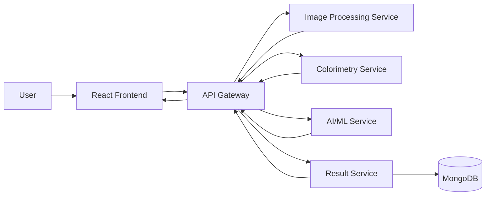

# Urine Test Strip Analysis Using Colorimetry and DevOps Microservices

Academic demonstration only. Not intended for medical diagnosis or treatment. Results must not be used as a substitute for professional medical testing.

This project is a working college mini-project prototype that analyzes an uploaded urine reagent strip image through independent microservices. It demonstrates image processing, colorimetry, explainable demo ML, MongoDB persistence, Docker Compose, automated tests, and CI/CD.

## Problem Statement

Urine reagent strips are interpreted by comparing pad colors with calibrated reference charts. This prototype shows how a software system can detect a strip in an image, locate configured reagent pads, extract pad colors, compare them with replaceable reference colors, and store/display the result. The reference data and ML dataset are demonstration data only.

## Objectives

- Upload and preview a strip image.
- Validate image quality for resolution, brightness, and blur.
- Detect a demo strip and ten reagent pads using a configurable layout.
- Extract representative RGB, HSV, and CIE Lab color values.
- Compare CIE Lab colors with configurable references using Euclidean Delta-E-style distance.
- Use a Random Forest model trained on synthetic demo data as an academic ML assist.
- Store complete analyses in MongoDB.
- Present results in a React dashboard through an API Gateway.
- Demonstrate microservices, Docker Compose, tests, and GitHub Actions CI.

## Architecture



## Services

| Service | Port | Responsibility |
|---|---:|---|
| Frontend | 5173 | React dashboard, upload, preview, bounding boxes, result table |
| API Gateway | 8088 (or 8080) | Single frontend API, orchestration, failure handling (configured via `API_GATEWAY_PORT`) |
| Image Service | 8000 | Image validation, strip detection, pad coordinates |
| Colorimetry Service | 8001 | Median color extraction, RGB/HSV/Lab, reference matching |
| AI Service | 8002 | Random Forest demo prediction from saved model |
| Result Service | 8003 | MongoDB storage and retrieval |
| MongoDB | 27017 | Analysis persistence |

## Colorimetry

RGB records red, green, and blue channel intensity. HSV separates hue, saturation, and value, which is easier to discuss for color families. CIE Lab is more perceptually uniform, so the prototype compares measured and reference colors in Lab space. The service uses the median color of the central pad crop because pad edges, paper background, glare, and shadows can distort a single-pixel or full-pad mean.

## AI/ML Use Case

`ml/train.py` creates a labelled synthetic dataset from `config/color_reference.json` by adding small color variations around demonstration references. It trains a Random Forest classifier and saves it to `ml/saved_model/urine_demo_rf.joblib`. The API service loads that saved model; it does not train on each request. Reference matching remains the primary classification mechanism because the dataset is not clinical.

## Configuration

`config/color_reference.json` contains:

- The demo strip layout.
- Pad order and parameter names.
- Replaceable RGB reference colors.
- The required academic/medical disclaimer.

Replace these values with manufacturer-specific calibrated data for serious validation work.

## Running With Docker

```bash
docker compose up --build
```

Open:

- Frontend: `http://localhost:5173`
- API Gateway health: `http://localhost:8088/health` (or configured `API_GATEWAY_PORT`)

Use `sample_data/synthetic_demo_strip.png` for the first demo upload. It is synthetic and labelled as demo data.

## Local Development

Train the demo model:

```bash
python ml/train.py
```

Run Python tests:

```bash
pip install -r requirements-dev.txt
pytest tests/python
```

Run API Gateway tests:

```bash
cd api-gateway
npm install
npm test
```

Run frontend:

```bash
cd frontend
npm install
npm run dev
```

## API Endpoints

API Gateway:

- `GET /health`
- `POST /api/analyze` with multipart field `image`
- `GET /api/results`
- `GET /api/results/:id`

Backend services:

- `GET /health` on every service
- `POST /process-image`
- `POST /analyze-colors`
- `POST /predict`
- `POST /results`, `GET /results`, `GET /results/{id}`

## Database Structure

Each analysis stores:

- Analysis ID and timestamp.
- Image metadata and quality report.
- Detected pad coordinates.
- RGB, HSV, Lab, hex color, reference match, and color distance.
- ML prediction and confidence.
- Final estimated demo result.
- Disclaimer.

No personal information is collected.

## Testing and CI/CD

Tests cover image validation, pad detection, color conversion, color distance matching, model prediction, result persistence, gateway health, success orchestration, and service failure. `.github/workflows/ci.yml` installs dependencies, trains the demo model, runs Python and Node tests, builds the frontend, and builds Docker images.

## Limitations

- This is not clinically validated.
- The demo image and ML data are synthetic.
- Real strips require standardized lighting, calibrated imaging, timing control, and manufacturer-specific reference charts.
- The simple detector targets a controlled demo layout, not every strip brand.
- Regulatory validation and clinical datasets are required for any medical use.

## Future Scope

- Add camera calibration cards and white balance correction.
- Support multiple manufacturer layouts.
- Add timed capture workflow.
- Use validated datasets and proper clinical evaluation.
- Add authentication and audit logging for regulated environments.
